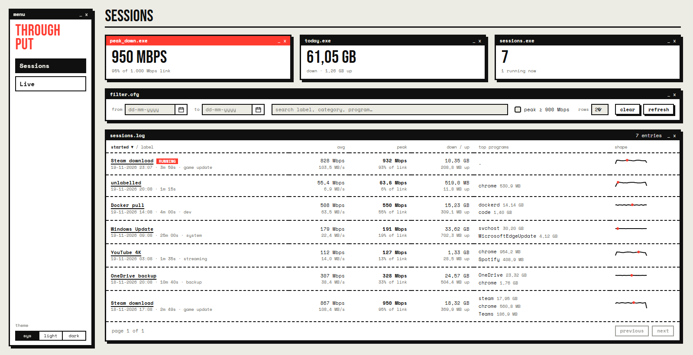
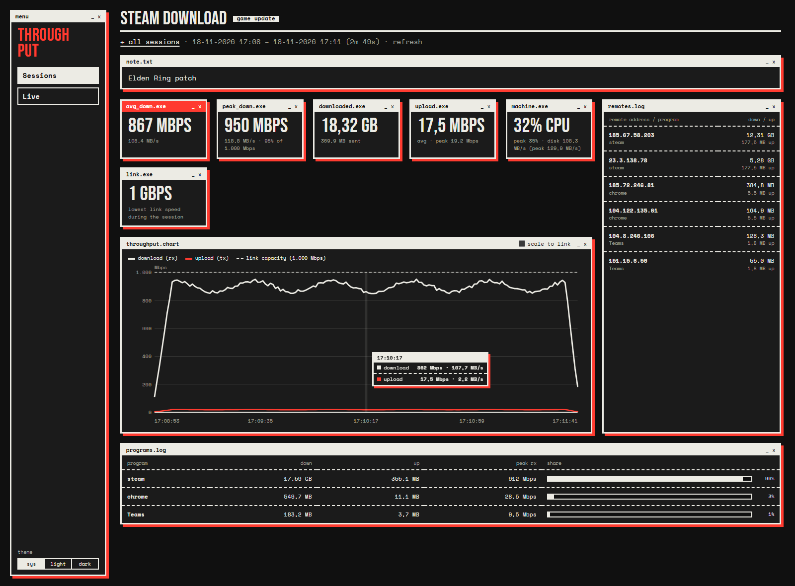
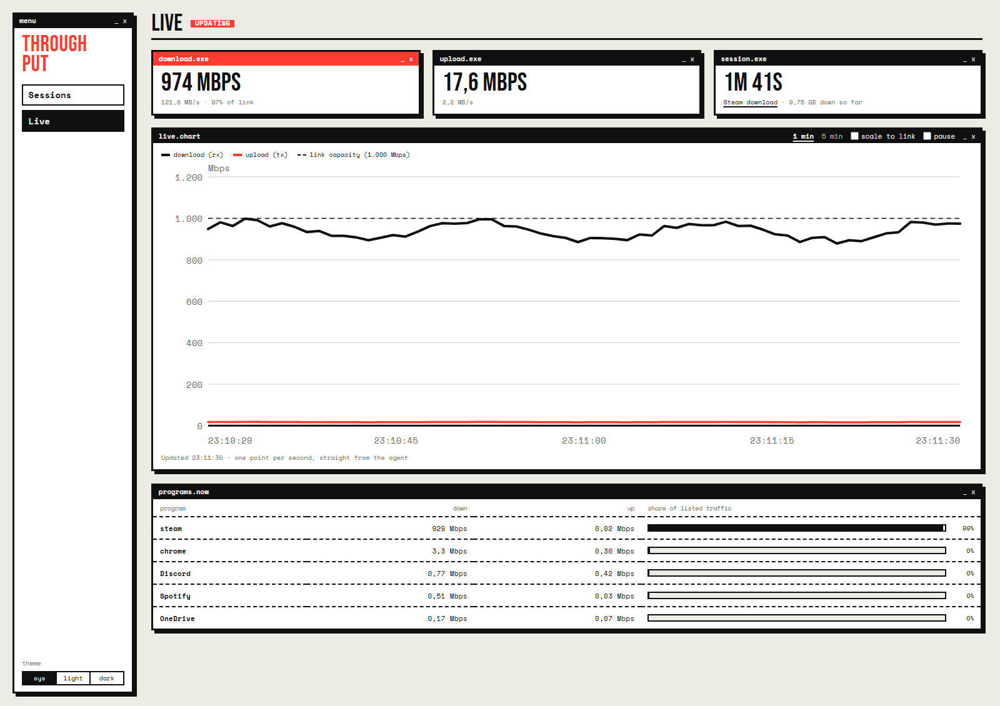
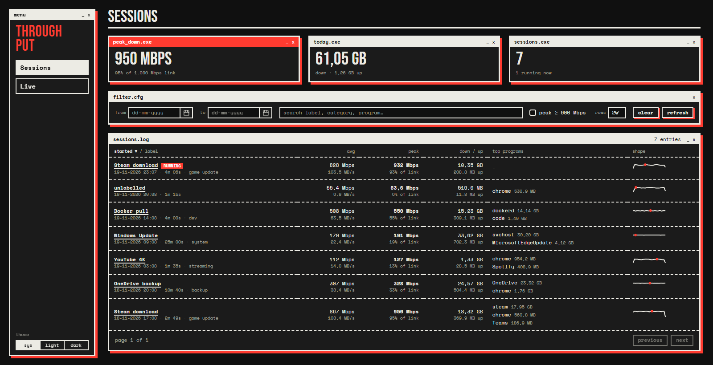
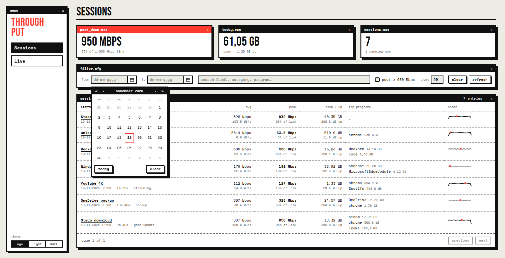
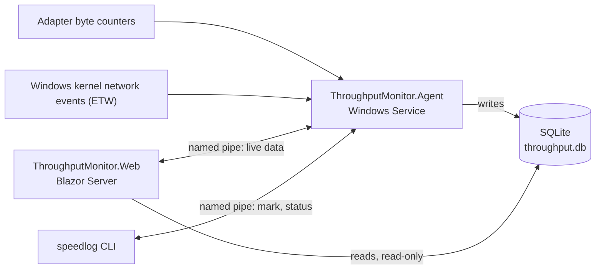

# Throughput Monitor

See how many bytes per second flow through your internet connection, **which programs** are responsible, and how it looked last week.

A small Windows service samples your network adapter every second, detects the moments you actually use the connection (a download, a game update, a backup), and records them in a local SQLite database. A web app shows the history, a live view and the details of every session.



> The screenshots in this README show generated sample data, not real traffic.

## What it does

- **Measures real throughput**: bytes per second received and sent by your Ethernet adapter, once a second, shown in Mbps and MB/s and as a percentage of your link capacity (1000 Mbps by default).
- **Finds your sessions automatically**: a session starts when traffic stays above a threshold (default 5 Mbps for 3 s) and ends after 10 s below it. Each session stores peak and average speed, totals, CPU and disk load, and the lowest link speed.
- **Shows which programs used the bandwidth**: per program and per remote server, using Windows kernel network events (ETW). Needs administrator rights, which the Windows service has.
- **Live view**: the last minute or five minutes of traffic, updated every second, straight from the agent's memory, even when nothing is being recorded.
- **Keeps the database tidy**: per-minute and per-hour rollups, raw data deleted after 30 days, sessions kept forever.
- **Label sessions from the command line**: `speedlog mark "Steam download" --category "game update"`.

## Screenshots

| Session detail (dark theme, with chart tooltip) | Live view (light theme) |
|---|---|
|  |  |

| Sessions page (dark theme) | Date picker (light theme) |
|---|---|
|  |  |

The interface follows your Windows light/dark setting by default and has a `sys | light | dark` switch in the menu window.

## How it works



1. **The agent** reads the adapter's byte counters every second and turns the difference into bytes per second, using the real elapsed time. A state machine groups active seconds into sessions. Samples are written in batches; outside sessions only one baseline sample per minute is stored.
2. **Per-program data** comes from the `Microsoft-Windows-Kernel-Network` ETW provider. All processes of one program (every `chrome.exe`) count as one row. Loopback traffic is ignored.
3. **A maintenance job** inside the agent writes rollups (min/avg/max/p95 per minute and hour) and applies the retention policy.
4. **The web app** opens the database **read-only**. For the live page it asks the agent for its in-memory last five minutes over a local named pipe.
5. **`speedlog`** talks to the same pipe to label the running session.

The agent and web app never share memory or files other than the database file (WAL mode lets the web app read while the agent writes).

## Features

### Agent (`ThroughputMonitor.Agent`)

- Samples every second; adapter chosen automatically (first wired, non-virtual, operational adapter) or by name.
- Session detection with configurable threshold and timings; the quiet tail never dilutes a session's averages.
- Per-second per-program rows (programs above 10 kB/s) and per-session totals per program and per remote address.
- Crash-safe: a session left open by a crash or power loss is closed at its last sample on the next start.
- Runs as a console app or as an elevated Windows Service. Logs to a rolling file (Serilog).
- Local command pipe (`mark`, `status`, `live`), reachable by logged-in local users only, never from the network.

### Web app (`ThroughputMonitor.Web`)

- **Sessions**: sortable, filterable (date range, search over label/category/note/program, "peak ≥ 900 Mbps"), paged, with a sparkline per row and summary tiles on top.
- **Session detail**: tiles (average/peak speed, totals, CPU, disk, link speed), throughput chart with your link capacity as a reference line, programs and remote servers.
- **Live**: download/upload tiles, current session, a chart of the last 1 or 5 minutes, and the busiest programs right now.
- Custom date picker and chart tooltip in the same visual style, light and dark themes, works on small screens.

### Command line (`speedlog`)

```text
speedlog mark "Steam download" --category "game update" --note "Patch 1.2"
speedlog status
```

`mark` labels the running session. With no session running, the label waits (30 minutes by default) and goes to the next one that starts.

## Getting started

### Requirements

- Windows 10 or 11 (developed and tested on Windows 11)
- [.NET SDK 11](https://dotnet.microsoft.com/download) (`global.json` pins `11.0.100`)
- Administrator rights to install the service and for per-program tracking (the adapter totals work without)

### Build and test

```powershell
dotnet build ThroughputMonitor.slnx
dotnet test ThroughputMonitor.slnx
```

### Try it without installing anything

Start the agent in a terminal (use an **administrator** terminal if you want per-program data):

```powershell
dotnet run --project src/ThroughputMonitor.Agent
```

Then, in another terminal, start the web app and open <http://localhost:5294>:

```powershell
dotnet run --project src/ThroughputMonitor.Web --launch-profile http
```

Start a large download and watch a session appear. Stop a console agent before installing the service, so two agents never write to the same database.

### Install the agent as a Windows Service

From an **administrator** PowerShell in the repository folder:

```powershell
.\scripts\install-service.ps1 -AddToPath
```

This publishes the agent to `C:\Program Files\ThroughputMonitor\Agent`, registers the service `ThroughputMonitorAgent` (starts automatically, restarts after a crash) and installs `speedlog`. Run it again to update. A full log is written to `%TEMP%\throughput-install.log`.

| Option | Meaning |
|---|---|
| `-AddToPath` | Add the `speedlog` folder to the machine PATH (optional; it changes a system setting) |
| `-NoStart` | Install without starting the service |
| `-InstallDir <path>` | Install somewhere else |
| `-DataAccessUser <user>` | User that may read the database for the web app (default: you). Pass `''` to skip the permission change |

Remove it with `.\scripts\uninstall-service.ps1` (add `-RemoveFiles` to delete the program files too). Your data in `C:\ProgramData\ThroughputMonitor` is never deleted by the scripts.

### Run the web app

```powershell
dotnet run --project src/ThroughputMonitor.Web --launch-profile https
```

Open <https://localhost:7206> (the profile also serves <http://localhost:5294>). For HTTPS the ASP.NET Core development certificate must be trusted: `dotnet dev-certs https --trust`.

The launch profiles are `http`, `https` and `IIS Express`; Rider and Visual Studio pick them up automatically.

## Configuration

Settings live in `appsettings.json` next to each program. Put machine-specific overrides in **`appsettings.local.json`** next to the agent's executable (the installer never overwrites it). Environment variables (`Agent__RawRetentionDays=60`) and command-line arguments (`--Agent:RawRetentionDays=60`) work too.

### Agent (`Agent` section)

| Setting | Default | Meaning |
|---|---|---|
| `DatabasePath` | `%ProgramData%\ThroughputMonitor\throughput.db` | SQLite file |
| `LogDirectory` / `RetainedLogFiles` | `logs` next to the database / `14` | Rolling daily log files |
| `AdapterNameContains` | empty | Part of an adapter name; empty = first wired, non-virtual adapter |
| `ActiveThresholdMbps` | `5` | Traffic at or above this counts as active |
| `StartAfterSeconds` / `EndAfterSeconds` | `3` / `10` | Active time before a session starts / quiet time before it ends |
| `FlushIntervalSeconds` | `5` | How often samples are written to the database |
| `IdleBaselineSeconds` | `60` | Outside sessions, one sample per this many seconds |
| `TrackProcesses` | `true` | Per-program tracking (needs administrator rights) |
| `ProcessMinBytesPerSec` | `10000` | A program gets a per-second row at or above this |
| `MaxRemotesPerProcess` | `20` | Remote addresses stored per program per session |
| `EnableCommandPipe` / `PipeName` | `true` / empty | Command pipe for `speedlog` and the live page |
| `PendingMarkMinutes` | `30` | How long a mark waits for the next session |
| `RollupIntervalMinutes` | `5` | How often rollups are written |
| `RawRetentionDays` | `30` | Raw samples older than this are deleted |
| `MinuteRollupRetentionDays` | `365` | Per-minute rollups older than this are deleted |

### Web (`Web` section)

| Setting | Default | Meaning |
|---|---|---|
| `DatabasePath` | same default as the agent | SQLite file written by the agent |
| `ReferenceLinkMbps` | `1000` | Your connection's capacity: "% of link" and the chart's reference line |
| `HighPeakMbps` | `900` | Threshold of the "peak ≥" quick filter |
| `DefaultPageSize` | `25` | Rows per page |
| `PipeName` | empty | Only if you changed `Agent:PipeName` |

## Data

The database lives in `C:\ProgramData\ThroughputMonitor\throughput.db` (plus `-wal` and `-shm` files; keep the three together when copying).

| Table | Content | Kept |
|---|---|---|
| `Sessions` | One row per session: times, label/category/note, peaks, averages, totals, CPU, disk, link speed | forever |
| `SessionProcessTotals` | Per session and program: bytes down/up, peak rates | forever |
| `SessionRemoteTotals` | Per session, program and remote address: bytes down/up | forever |
| `Samples` | One row per second during sessions (plus one per minute when idle) | 30 days |
| `ProcessSamples` | Per-second rows per program during sessions | 30 days |
| `Rollups` | Min/avg/max/p95 per minute and per hour | minutes: 1 year, hours: forever |

Rates are stored as bytes per second and times as UTC. Schema changes are EF Core migrations, applied by the agent at startup.

## Security and privacy

- Everything stays on your machine. Nothing is sent anywhere.
- The web app listens on `localhost` only, opens the database read-only and has no write endpoints.
- The command pipe accepts logged-in local users and denies network clients. Its commands can only label sessions and read live numbers.
- The database contains the names of programs that used the network and the addresses of the servers they talked to. Treat the file accordingly.
- The service runs as `LocalSystem` because ETW needs administrator rights. The installer gives one user modify access to the data folder (SQLite's WAL mode needs write access to read); use `-DataAccessUser ''` to manage permissions yourself.

## Project layout

```text
src/
  ThroughputMonitor.Core/         Entities, EF Core DbContext + migrations, pipe contract
  ThroughputMonitor.Agent/        Worker service: sampling, sessions, ETW, rollups, pipe server
  ThroughputMonitor.Cli/          speedlog.exe
  ThroughputMonitor.Web/          Blazor Server app
  ThroughputMonitor.SamplerSpike/ Throwaway: print adapter throughput
  ThroughputMonitor.EtwSpike/     Throwaway: print per-program throughput (run as admin)
tests/
  ThroughputMonitor.Agent.Tests/  Rates, sessions, process totals, rollups, retention, pipe, live data
  ThroughputMonitor.Web.Tests/    Queries, chart data, formatting, calendar, live service
scripts/                          install-service.ps1, uninstall-service.ps1
docs/screenshots/                 Images used in this README
PLAN.md                           The original design notes (written before building; the code is the source of truth)
```

Built with .NET 11, Entity Framework Core 11 (SQLite), Blazor Server, [TraceEvent](https://github.com/microsoft/perfview) (ETW), Serilog and xUnit. The interface fonts (Space Mono and Bebas Neue) are bundled under the SIL Open Font License; see `src/ThroughputMonitor.Web/wwwroot/fonts/README.txt`.

## Troubleshooting

| Symptom | Likely cause and fix |
|---|---|
| Web app says "No database found" | The agent hasn't created it yet. Start the service, or check `Web:DatabasePath` |
| Web app can't open the database | Your user has no access to `C:\ProgramData\ThroughputMonitor`. Re-run the installer, or pass `-DataAccessUser` |
| Live page shows "agent offline" | The service isn't running or is an old version: `Get-Service ThroughputMonitorAgent`, then re-run the installer |
| Live page says per-program traffic needs administrator rights | The agent isn't elevated. The service is; a console agent needs an administrator terminal |
| Installer window closes immediately | Start it from an elevated PowerShell, or read `%TEMP%\throughput-install.log` |
| HTTPS connection refused | Use the `https` launch profile (<https://localhost:7206>) and trust the dev certificate; or use <http://localhost:5294> |
| `System.Byte[]` or loopback addresses in older sessions | Fixed in the agent; rows stored by earlier versions are not rewritten |
| Build fails because a file is locked | A running web app locks its output. Stop it first |

## Limitations and ideas

- Windows only (performance counters and ETW).
- One adapter at a time. The automatic choice only considers wired Ethernet adapters; for anything else set `Agent:AdapterNameContains` (not tested with Wi-Fi).
- Adapter counters include packet headers, so they read about 3-5% above what a speed test reports.
- Remote ports and host names are not stored yet.
- Ideas: a summary page (peak, averages, GB per day/week/month), auto-refreshing session list, editing labels in the web app, alerts when speed drops.
